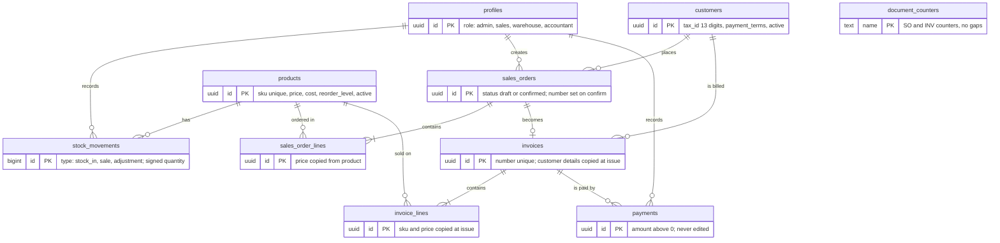

# Siam Bean ERP

A mini ERP for Siam Bean Co., a Bangkok coffee-bean distributor. A confirmed sales order deducts stock and issues a numbered invoice in one step, the accountant records payments, and the owner sees live numbers on a dashboard. Business brief: [docs/scenario.md](docs/scenario.md). Vocabulary: [GLOSSARY.md](GLOSSARY.md). Spec and tickets: [.scratch/mini-erp/](.scratch/mini-erp/). Decisions: [docs/adr/](docs/adr/).

**Stack:** Postgres 16 (Docker locally, Supabase when deployed), Python FastAPI managed with uv, React + TypeScript + Vite.

## Run it locally

You need Docker, [uv](https://docs.astral.sh/uv/) and Node 20+.

```bash
npm install                  # frontend dependencies
(cd backend && uv sync)      # backend dependencies
npm run db                   # start Postgres in Docker (port 54329)
npm run reset-db             # build the schema and load the demo data
npm run dev:backend          # API on http://localhost:8000  (docs at /docs)
npm run dev:frontend         # app on http://localhost:5173
```

Open http://localhost:5173 and log in with a demo account below. `npm run reset-db` returns the database to the clean demo state at any time.

## Demo accounts

Every account uses the password `demo1234`. These exist only in the local demo data.

| Role | Person | Email | Can do |
| --- | --- | --- | --- |
| Admin | Khun Somchai | somchai@siambean.test | Everything, including users and prices |
| Sales | Nok | nok@siambean.test | Customers; create and confirm orders; view invoices |
| Sales | Ploy | ploy@siambean.test | Same as Nok |
| Warehouse | Lek | lek@siambean.test | Stock in and adjustments; view products |
| Accountant | Fon | fon@siambean.test | Record payments; view invoices, products and customers |

## Tests

```bash
npm test          # 199 backend tests against a real Postgres (each test rolls back)
npm run test:e2e  # browser tests of the Café Lune flow (own database and ports)
```

Tests go through the HTTP API, the single seam agreed in the spec, and a few browser tests cover the US-1 flow. Tests need the Docker database running (`npm run db`).

## The Café Lune story (US-1 to US-4)

1. Log in as **Nok**, open Orders, New order, choose Café Lune, add 20 of ARB-1KG, confirm.
2. Stock for ARB-1KG goes from 170 to 150. Order `SO-0001` and invoice `INV-0001` are issued: 9,000.00 + 630.00 VAT = **9,630.00 THB**.
3. Log in as **Fon**, open Accounting, open `INV-0001`, record the full payment. The invoice becomes Paid.
4. The Dashboard shows open receivables back at 0.00 THB.
5. Log in as **Lek** and open `/orders`: access denied. The API returns `403` for the same action.

## Database schema



Two views derive values instead of storing them: `product_stock` (On Hand is the sum of stock movements) and `invoice_summary` (paid, balance, status and overdue come from payments and dates).

Business rules enforced in the database, not only on screen:

- `confirm_sales_order()` checks stock, takes the next `SO-` and `INV-` numbers, writes the stock movements and issues the invoice in one transaction, or does nothing at all ([ADR 0001](docs/adr/0001-confirm-order-runs-in-a-database-function.md), [ADR 0002](docs/adr/0002-gapless-document-numbers-from-a-counter-table.md)).
- A trigger on `stock_movements` makes negative stock impossible, even under concurrent confirms.
- Triggers block any update or delete of invoices, invoice lines and payments.
- Check constraints cover SKU format, 13-digit tax ID, price and quantity limits and payment terms.
- Roles are checked on the server for every API endpoint; the API returns `403` for the wrong role.

## What is done

| Story | Status |
| --- | --- |
| US-1 Sales order to invoice | Done locally, tested through the API and the browser |
| US-2 Low stock | Done locally |
| US-3 Roles | Done locally (`403` plus the access-denied page) |
| US-4 Payment | Done locally (full and partial payments) |
| US-5 Search | Done locally (by name, 20 per page) |
| Public URL on Cloudflare | **Not done.** Needs the team's Cloudflare and Supabase accounts, plus the Hyperdrive transaction spike |

## Who did what

| Name | Student ID | Module owned | GitHub username |
| --- | --- | --- | --- |
|  |  |  |  |
|  |  |  |  |
|  |  |  |  |
|  |  |  |  |

## Before deploying

- Set `JWT_SECRET` to a long random value; the built-in default is for local development only.
- Local login (`/api/auth/login`) signs its own tokens. With Supabase Auth, the frontend logs in through Supabase and the same token check applies; set `JWT_SECRET` to the Supabase JWT secret.
- Never commit `.env`. Copy `.env.example` to `backend/.env` and fill it in.
